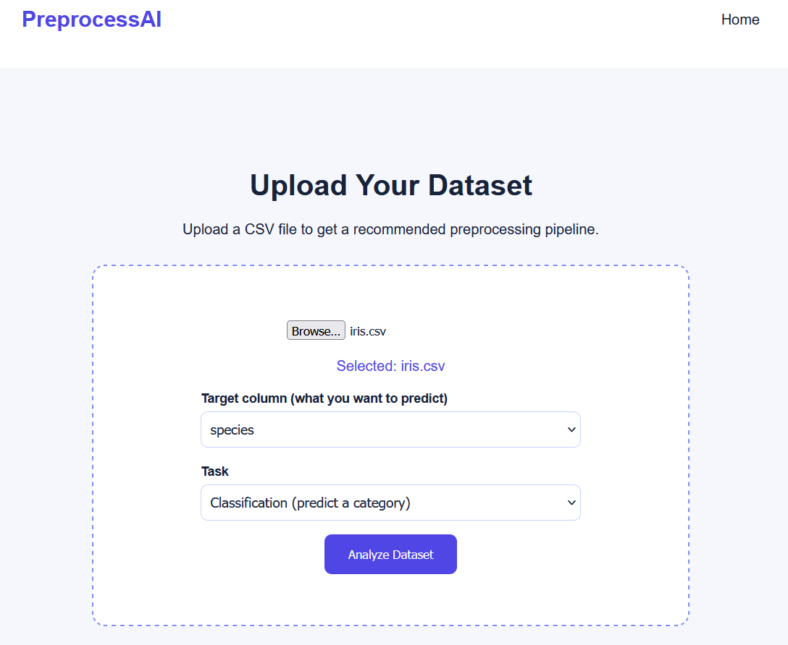
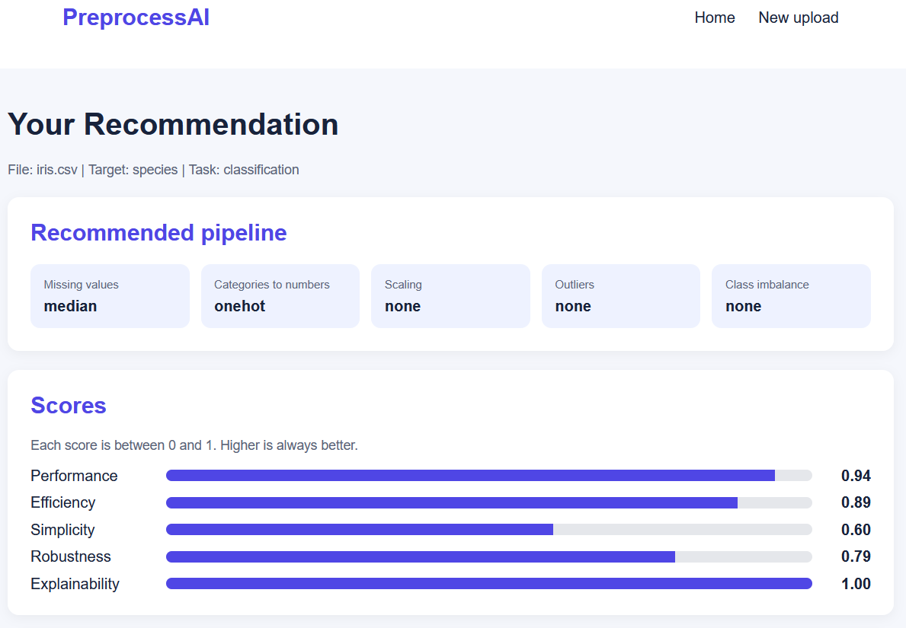
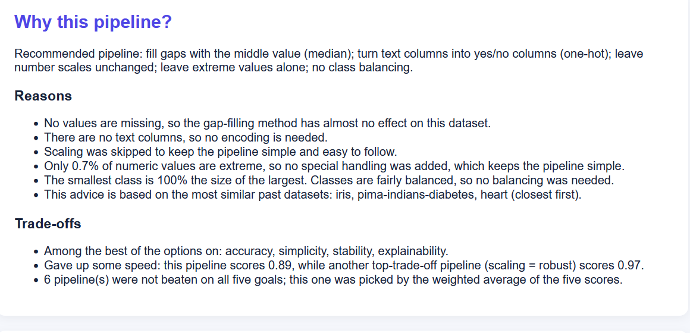
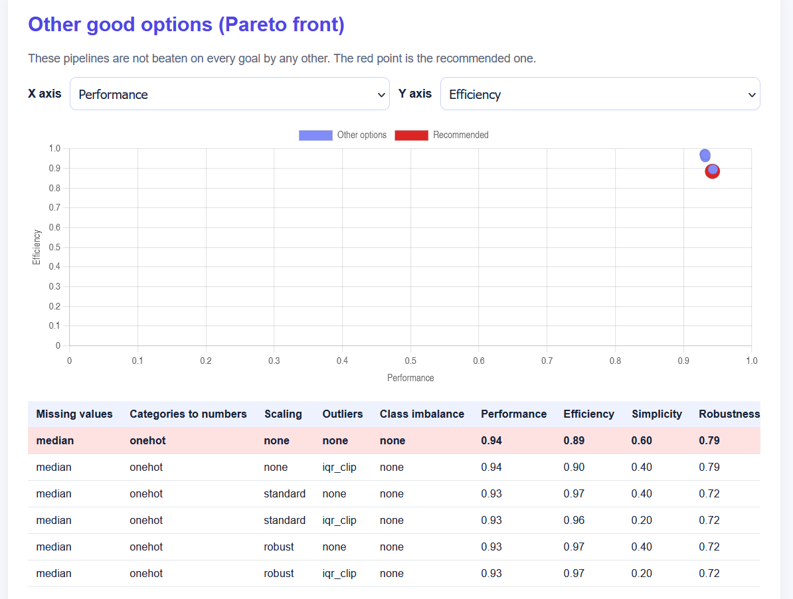
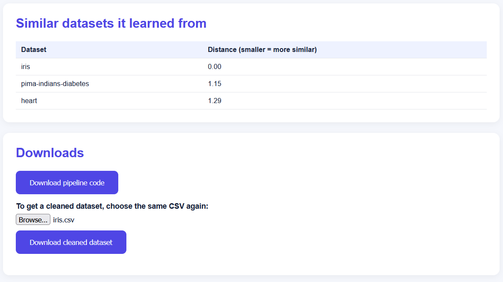

# PreprocessAI: preprocessing pipeline recommender

**Multi-Objective Meta-Learning for Explainable Preprocessing Pipeline Recommendation**

Upload a CSV file, choose the target column and the task (classification or regression), and the system recommends a preprocessing pipeline for it: how to fill missing values, encode categories, scale numbers, treat outliers and handle class imbalance. It also explains the choice, lets you download the pipeline as Python code, and returns the cleaned dataset.

Most tools pick the pipeline that gives the best model score. This project also weighs four other goals, so the recommendation is a trade-off and not only an accuracy number:

| Goal | Meaning |
|---|---|
| Performance | cross-validated model score |
| Efficiency | how cheap the pipeline is to run |
| Simplicity | how few and how simple the steps are |
| Robustness | how stable the score is across folds |
| Explainability | how easy the pipeline is to explain |

## How it works

1. **Meta-features.** The uploaded dataset is described by a set of numbers (size, share of missing values, number of numeric and categorical columns, class balance and so on).
2. **Experience database.** `experiments/results.csv` holds 1,291 evaluated dataset and pipeline combinations from 30 public datasets (18 classification, 12 regression). Each row has the five scores above, each between 0 and 1.
3. **Recommendation.** The recommender finds the 3 most similar datasets, predicts how each candidate pipeline would score on yours, and keeps the Pareto front (the pipelines that no other pipeline beats on every goal at once). The best trade-off from that front is the recommendation.
4. **Explanation, code and cleaning.** The explainer gives the reasons and trade-offs in plain text, the code exporter writes a runnable scikit-learn pipeline, and the cleaner applies the pipeline to your file.

## Results

Evaluated by leave-one-dataset-out (each dataset is held out while the recommender learns from the other 29), with k = 3 neighbours, on 30 datasets:

| Compared with | Accuracy only | All five goals |
|---|---|---|
| Default pipeline | +0.037 (p < 0.001) | +0.012 (p = 0.013) |
| One fixed best pipeline | -0.006 (p = 0.142) | +0.009 (p = 0.203) |
| Random pipeline | +0.033 | +0.087 |

The recommender is clearly better than random and than the default pipeline. Against one fixed best pipeline the difference is not statistically clear. The effects are small and many comparisons were made, so the p-values should be read with care. The weakest case is the `mushrooms` dataset (only 15 pipelines were evaluated for it).

## Project structure

```
backend/        engine and API
  meta_features.py      describes a dataset with numbers
  pipeline_space.py     the candidate pipelines
  evaluator.py          the five scores for a pipeline
  meta_recommender.py   finds similar datasets, predicts scores
  pareto_selector.py    Pareto front and best trade-off
  explainer.py          plain-text explanation
  code_export.py        exports a pipeline as Python code
  data_cleaner.py       applies a pipeline to a dataset
  api.py                FastAPI app
experiments/    building the experience database and evaluating it
  data/                 the 30 datasets and datasets.csv
  results.csv           the experience database
frontend/       website (plain HTML, CSS and JavaScript)
tests/          automated tests
INTEGRATION_CONTRACT.md  what the API and the website send each other
```

## Setup

You need Python 3.13.

```
python -m venv .venv
.venv\Scripts\activate          # Windows (PowerShell)
# source .venv/bin/activate     # Linux and macOS
pip install -r requirements.txt
```
## Screenshots

Upload page:



Recommended pipeline and scores:



Explanation:



Pareto chart of the best trade-offs:



Downloads (pipeline code and cleaned dataset):



## Run the website

Start the API, then the website, in two terminals from the project root:

```
python -m uvicorn backend.api:app --port 8000
```

```
cd frontend
python -m http.server 5500 --bind 127.0.0.1
```

Open http://127.0.0.1:5500 in Chrome or Edge, log in with any email and password (the login is a placeholder for now), then upload a CSV file. The address of the API is set in `frontend/config.js`.

Two files to try from `experiments/data/`: `iris.csv` (target `species`, classification) and `insurance.csv` (target `charges`, regression).

## API

| Endpoint | What it does |
|---|---|
| `GET /health` | `{"status": "ok"}` |
| `POST /profile` | meta-features of an uploaded file |
| `POST /recommend` | form fields `file`, `target`, `task`; returns the recommended pipeline, its scores, the Pareto front, the similar datasets and a `recommendation_id` |
| `POST /explain` | JSON `{"recommendation_id": "..."}`; returns `summary`, `reasons`, `tradeoffs` |
| `GET /export/{recommendation_id}` | the pipeline as a Python file |
| `POST /clean` | form fields `recommendation_id` and `file`; returns the cleaned CSV |

The details are in `INTEGRATION_CONTRACT.md`. Interactive documentation is at http://127.0.0.1:8000/docs while the API runs.

## Tests

```
pip install -r requirements-dev.txt
python -m pytest tests -q
```

The tests run automatically on every push and pull request (GitHub Actions). Some of them run the real engine on files from `experiments/data/`.


## Run with Docker

Build the image:

```bash
docker build -t preprocessai .
```

Start the API on port 7860:

```bash
docker run -p 7860:7860 preprocessai
```

Check that it is running:

```bash
curl http://localhost:7860/health
```

The API documentation is at http://localhost:7860/docs. GitHub also builds the image and runs a recommendation inside it on every pull request (the "Docker" check).


## Rebuilding the experience database

```
python experiments/build_experience_db.py --help
```

The options include `--max-rows`, `--max-candidates`, `--only`, `--redo` and `--fresh`. Which datasets are used, with their target column, task and cleaning flags, is listed in `experiments/data/datasets.csv`.

## Team workflow

Nobody pushes to `main`. Each change goes on a branch named `feature/short-name`, then a pull request into `main`, and it is merged after the Tests check is green.

## Status and next steps

- Done: the recommendation engine, the evaluation, the API, and the website pages for upload, results and downloads.
- Next: recommendations are kept in memory only (lost on restart), so they will be stored on disk; text cleaning of messy uploads will move into the backend; Docker and deployment on Hugging Face Spaces; real Google and GitHub sign-in with a profile page.

## Datasets

The 30 datasets are public datasets, mostly from Kaggle and the UCI repository. Each keeps its own licence and terms; check the original source before reusing a file.